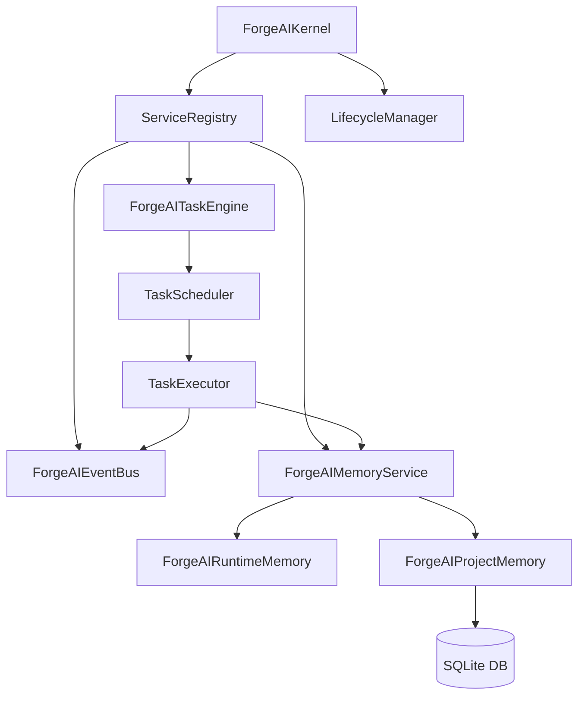

# Technical Design Document - Sprint 3: Execution Core

This document outlines the detailed technical specifications and design choices for Sprint 3: Execution Core, which incorporates the Event Bus, Memory Engine, and Task Engine.

---

## 1. System Architecture

The Sprint 3 architecture integrates into the core boot lifecycle of the ForgeAI Kernel. The dependency direction flows from the task scheduling engine down to memory persistence and event routing.

---

## 2. Component Specifications

### 2.1. Event Bus
The Event Bus decouples publishers from subscribers and runs thread-safe notifications.
- **Model:** `Event` contains `event_type`, `timestamp`, `metadata`, and `data` (payload).
- **Interface:** `EventBus` defines standard `publish()`, `publish_async()`, `subscribe()`, and `unsubscribe()` signatures.
- **Implementation:** `ForgeAIEventBus` uses `threading.RLock` to synchronize access. Async subscribers are automatically identified via `inspect.iscoroutinefunction` and scheduled onto the active loop, while sync subscribers are called directly (or offloaded to thread-pools during async publishing).

### 2.2. Memory Engine
The Memory Engine acts as the state manager.
- **Runtime Memory:** A thread-safe, ephemeral in-memory cache tracking execution state, active tasks, and loaded plugins.
- **Project Memory:** A durable storage manager delegate tracking metadata, completed task results, and file generation histories.
- **Persistence Provider:** Uses `SQLitePersistenceProvider` implementing `KeyValueStore` to save states durably in `forge_data/databases/project_memory.db`. Values are serialized via JSON and protected by threading locks.

### 2.3. Task Engine
The Task Engine validates and executes Directed Acyclic Graphs (DAGs) of tasks.
- **Cycle & Dependency Validation:** `TaskDAG` parses a list of tasks, checks for cycle paths using DFS coloring, and returns topological sort indices. Throws `DAGValidationError` if invalid.
- **Task Executions:** `TaskExecutor` coordinates sync/async task callables, running blocking callables in threads to protect loop latency, and implements retry policies with exponential backoff and jitter.
- **Parallel DAG Scheduling:** `TaskScheduler` executes ready tasks in parallel up to concurrency limits, handles cancellations, and propagates cascading skips recursively when dependencies fail.

---

## 3. Concurrency & Thread-safety
- **Locks:** `threading.RLock` and `threading.Lock` guard database connection handles, subscription lists, and in-memory caches.
- **Loop Offloading:** Sync callables submitted as tasks are executed via `asyncio.to_thread` to prevent blocking the async scheduler thread.
- **Task Isolations:** Schedulers track active `asyncio.Task` futures in dictionary tables, allowing targeted loop cancellation.

---

## 4. Integration & Compatibility
- **Backward Compatibility:** Public interfaces of v0.2.0 remain untouched. New engines are dynamically registered inside the ServiceRegistry during Kernel boot.
- **Lifecycle hooks:** All Sprint 3 modules subclass `LifecycleComponent`, allowing automatic startup and graceful shutdown sequences on boot and exit.
