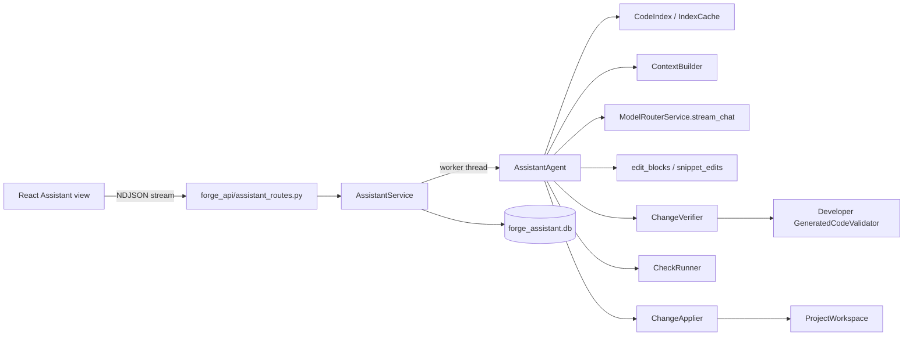

# Assistant (local coding assistant)

The Assistant Plugin is ForgeAI's interactive mode: you point it at an existing project and either ask questions about the code or describe a change. It runs entirely on the local model (Ollama by default), stores every conversation on disk, and never writes a file until you approve the change, unless you turn on auto-fix.

## Why it exists
The build workflows generate new projects from a goal. Day-to-day coding is different: you work on your own code, one focused request at a time. Small local models (`qwen2.5-coder:3b` on an iGPU) can't do that reliably when their output is trusted as-is. In the first live tests they invented helper methods, left out imports, rewrote whole files when asked for a one-line change, and copied the format of their earlier replies.

The assistant makes up for that by doing what an experienced engineer does around every edit, in code rather than in the model:

| Step | What the code does | Small-model failure it handles |
|---|---|---|
| Find context | BM25 search over identifier-aware tokens, `@file` mentions, and file paths found in pasted tracebacks. Edit mode shows whole files; small files are always shown whole. | The model guesses instead of reading, or edits code it was never shown |
| Reproduce first | If you describe a failure and a check command is set, the check runs before the model is asked, and its output goes into the prompt | It explains a test failure from the code without seeing the real error |
| Parse edits | SEARCH/REPLACE blocks. The parser tolerates fences, decorated file names and resized markers. Matching tolerates trailing whitespace, a consistent indent shift and missing blank lines. | Near-miss formatting |
| Recover formats | A reply that restates a whole file, or whole functions or classes, becomes the edit, but only if nothing that existed is dropped | The model ignores the edit format |
| Reject bad edits | Ambiguous or non-matching SEARCH text, `...` in REPLACE, and empty SEARCH on an existing file are refused. No-op blocks are skipped. | Deleting code, editing the wrong place |
| Check statically | The Developer plugin's validator runs on the whole project before and after the change (syntax, JSON/TOML, imports, names imported from local modules, undefined names), plus a `self.attr`-never-defined check. Only new problems count. | Calling helpers that don't exist, breaking other modules |
| Retry with reasons | Failures go back to the model with the exact problem and the closest matching lines (up to `max_edit_attempts`) | One wrong token wastes the whole request |
| Verify by running | After apply, your check command runs. In auto-fix mode, failures feed another round (up to `max_fix_rounds`). | Code that parses but doesn't work |

Measured on the sample todo project with `qwen2.5-coder:3b`, iGPU, 8k context:
- **Auto-fix (CLI test):** asked to add `complete()`, the model first called a helper it hadn't written. The tests failed, the failure went back to the model, the second round added the helper, and all 3 tests passed. About 80 s end to end.
- **Ask:** asked why the tests fail, the answer was wrong until the reproduce step put the real `AttributeError` in front of the model.
- **Change:** a clean, minimal diff came after one retry. Replaying the stored replies shows that its failed first tries would have been accepted directly by the format fallbacks.

## Safety
- **Nothing the model writes is executed.** Static checks read code as text (`ast`, `json`, `tomllib`). The only command ever run is the check command *you* configure, which runs in the project folder without a shell (so `&&`, pipes and redirects are not interpreted), with a timeout that kills the whole process tree. A leading `python` uses the project's `.venv`/`venv` interpreter when one exists.
- **Writes stay inside the project.** Absolute paths, `..`, and protected folders (`.git`, `node_modules`, `.venv`, build outputs, ...) are refused. Writes are atomic and keep the file's line endings.
- **Nothing is overwritten behind your back.** A change is only applied if every file is still exactly as it was when proposed, and only undone if every file is still as the change left it. If a write fails part-way, the files already written are restored.
- **Local-only API.** Every `/api/assistant/*` request must carry an `X-ForgeAI-Client` header (a cross-site page can't send it without passing this API's CORS policy) and use a loopback `Host` (defeats DNS rebinding).
- In auto-fix mode, a change with static errors is never applied automatically.

## Architecture

- `forge_core/model_router` gained `stream_chat` on `ModelProvider` and `ModelRouterService`. Ollama streams NDJSON and OpenAI-compatible servers stream SSE. A provider without streaming inherits a fallback that returns the whole reply as one chunk, so existing providers are unaffected.
- Each reply runs on its own worker thread (`TurnHandle`), and its events reach the HTTP stream through a queue. Closing the stream (or `POST .../stop`) cancels generation between tokens, and the partial reply is still stored.
- One reply at a time per conversation. Different conversations queue at the model (`OLLAMA_NUM_PARALLEL=1`).

## Data model
Stored in `forge_data/databases/forge_assistant.db` (schema version in `PRAGMA user_version`, newer schemas refused):

| Table | Holds |
|---|---|
| `conversations` | Title, project folder, check command, auto-fix flag, timestamps |
| `messages` | User requests, assistant replies (with the code they were shown, attempts, token use, timing) and check results |
| `change_sets` | Proposed edits: before/after content per file, static check results, the check run after applying, and status `pending` / `applied` / `discarded` / `reverted` |

Deleting a conversation deletes its messages and change sets and compacts the database; project files are never touched.

## Configuration (`assistant` section)
| Key | Default | Meaning |
|---|---|---|
| `model` | `""` | Model for the assistant; empty uses `models.default_model` (env `FORGE_ASSISTANT_MODEL`) |
| `context_tokens` | `8192` | Context window requested from the model (`num_ctx`; env `FORGE_ASSISTANT_CONTEXT_TOKENS`). For a 3B model, 8k costs about 300 MB of extra memory over 4k |
| `answer_tokens` / `edit_tokens` | `1024` / `2048` | Reply length limits |
| `temperature` | `0.2` | Sampling temperature |
| `max_edit_attempts` | `3` | Tries per change (initial + retries after unusable or breaking edits) |
| `max_fix_rounds` | `3` | Apply → check → fix rounds in auto-fix mode |
| `check_timeout` | `300` | Seconds before a check command is stopped |
| `max_indexed_files` / `max_file_bytes` | `4000` / `262144` | Indexing limits; larger files are not read or edited |

## API
All endpoints require the `X-ForgeAI-Client` header and a loopback host.

| Endpoint | Description |
|---|---|
| `GET /api/assistant/status` | Model, limits, active conversations, storage |
| `GET/POST /api/assistant/conversations` | List / create (`project_root`, `check_command`, `auto_fix`, `title`) |
| `GET/PATCH/DELETE /api/assistant/conversations/{id}` | Conversation with messages and change sets / update settings / delete |
| `GET /api/assistant/conversations/{id}/files` | Indexed project files (for attaching) |
| `POST /api/assistant/conversations/{id}/messages` | `{content, mode: "ask"\|"edit", attached}`. Streams NDJSON events: `message`, `context`, `token`, `attempt`, `status`, `change_set`, `error`, `done` |
| `POST /api/assistant/conversations/{id}/stop` | Stop the reply in progress |
| `POST /api/assistant/conversations/{id}/check` | Run the check command now |
| `POST /api/assistant/changes/{id}/apply` · `/discard` · `/revert` | Apply (then run the check), discard, or undo a change |

## Usage
1. Start Ollama, the API (`uvicorn forge_api.main:app --port 8420`) and the frontend (`npm run dev` in `forge_frontend`).
2. Switch the top bar to **Assistant**, choose a project folder and, ideally, a check command such as `python -m pytest -q`.
3. Use **Ask** for questions and **Change** for edits. Name files with `@name` (partial paths work) or attach them.
4. Review the diff and static check result, then **Apply change**. The check runs, and **Undo change** restores the files. If the check fails, **Ask ForgeAI to fix it** sends the failure back.

## Known limits
- The model is the ceiling. A 3B model handles focused, single-file changes and questions about code it was shown. It struggles with multi-file refactors, subtle logic, and anything that needs more code than fits in the context window. The checks catch broken edits; they cannot make a wrong idea right. A bigger model (set `assistant.model`) helps directly.
- Static checks are Python-only (plus JSON/TOML). For other languages, the check command is the only verification.
- Search is lexical (BM25), not semantic. A question phrased with none of the code's words may miss the right file, so name it with `@`.
- Only the root `.gitignore` is honoured.
